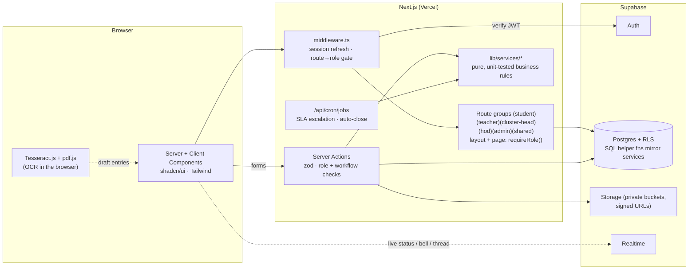

# CampusConnect · BMSIT&M

Role-based college communication and management portal for **BMS Institute of Technology and Management** (final-year SEPM major project).

- **Students** find teachers and their live availability, see today's classes, raise and track complaints, and read notices.
- **Teachers** manage their timetable (manual grid or OCR scan), mark unavailability, toggle meeting availability and answer complaint response requests.
- **Cluster Heads** (one per cluster) monitor their cluster and handle routed complaints.
- **HODs** (one per department) monitor all clusters, handle escalations and confidential complaints, and publish department notices.
- **Admin** configures departments, clusters, sections, users, period slots, holidays and college-wide notices.

The two flagship modules are **Timetable + Live Availability** and **Complaint Management** (routing, SLA and escalation).

## Project documents

| Document | Contents |
|---|---|
| [docs/01-SRS.md](docs/01-SRS.md) | Requirements: actors, use cases, FR-1…FR-43, NFR-1…NFR-9 |
| [docs/02-Design.md](docs/02-Design.md) | Architecture, ER diagram, availability flowchart, complaint state machine, sequence diagrams, security model, design decisions |
| [docs/03-Test-Report.md](docs/03-Test-Report.md) | Test strategy, all unit and E2E cases, traceability, defects found, results |
| [docs/04-Project-Management-and-Viva.md](docs/04-Project-Management-and-Viva.md) | Process model, risk register, timed demo script, viva Q&A, code tour |

## Tech stack

Next.js 15 (App Router, TypeScript, Server Actions) · Tailwind CSS v4 + shadcn/ui · react-hook-form + zod · Supabase (Postgres + RLS, Auth, Storage, Realtime) · date-fns-tz (Asia/Kolkata) · Tesseract.js + pdf.js (OCR) · Recharts · Vitest · Playwright.

## Setup

```bash
npm install
cp .env.example .env.local      # fill in the values (see below)
npm run db:migrate              # applies supabase/migrations/*.sql
npm run seed                    # loads the BMSIT&M demo data (re-runnable)
npm run dev                     # http://localhost:3000
```

If you can't use a direct DB connection, paste each file in `supabase/migrations/` into the Supabase SQL Editor in filename order.

### Environment variables

| Variable | Purpose |
|---|---|
| `NEXT_PUBLIC_SUPABASE_URL`, `NEXT_PUBLIC_SUPABASE_ANON_KEY` | Supabase project (the anon/publishable key is public) |
| `SUPABASE_SERVICE_ROLE_KEY` | **Server only.** Used by server actions after role checks, seed and jobs |
| `SUPABASE_DB_URL` | Direct Postgres URL (session pooler, port 5432) for `db:migrate` / `seed`; URL-encode the password (`@` → `%40`) |
| `NEXT_PUBLIC_DEMO_MODE` | `true` shows one-click demo logins and the **Simulate time** control |
| `DEMO_PASSWORD` | Password of every seeded account (default `Demo@12345`) |
| `CRON_SECRET` | Protects `/api/cron/jobs` (SLA auto-escalation + auto-close) |
| `IMPORT_DEFAULT_PASSWORD` | Password given to CSV-imported accounts (default `Bmsit@2026`) |
| `NEXT_PUBLIC_COLLEGE_NAME`, `…_SHORT_NAME`, `…_ACADEMIC_YEAR_LABEL` | Display text |

## Real use vs. demo

The project database is in **real mode**:
- demo data has been removed and `NEXT_PUBLIC_DEMO_MODE=false`;
- the 7 departments, period slots, settings and public holidays are kept;
- everything else is created by real users.

- **Sign-up:** students type their **section** (e.g. `5J`) and **cluster** (e.g. `3`, saved as "Cluster 3"). Teachers and Cluster Heads type their cluster. A cluster or section that doesn't exist yet is created automatically. An existing section must be entered with its own cluster, otherwise sign-up explains the correct one. Each cluster gets one Cluster Head and each department one HOD, claimed atomically.
- **First admin:** run `npm run create-admin -- you@bmsit.in "Your Name"`; it prints a one-time password. Change it on **My Account → Change password**, then deactivate the temporary `admin@campusconnect.test` on Admin → Users.
- **Going from demo to real again:** run `npm run demo:remove -- --yes`. It removes `@bmsit.test` / `@campusconnect.test` accounts and demo data, and keeps real accounts.
- **Demo data:** `npm run seed` refuses to run while real accounts exist, because it would erase college data. For demos and the end-to-end tests, use a **separate Supabase project** with `NEXT_PUBLIC_DEMO_MODE=true`.

## Demo accounts (demo project only)

Password: `Demo@12345`. With demo mode on, the login page has one-click buttons.

| Role | Email | Who |
|---|---|---|
| Student | student@campusconnect.test | Aarav Kumar · 1BY24CS045 · CSE 5A · Cluster 2 |
| Teacher | teacher@campusconnect.test | Prof. Kavitha Rao · CSE Cluster 2 (DBMS for 5A/5B) |
| Cluster Head | clusterhead@campusconnect.test | Dr. Rajesh Sharma · CSE Cluster 2 |
| HOD | hod@campusconnect.test | Dr. Meena Iyer · CSE |
| Admin | admin@campusconnect.test | Mr. Suresh Patil |
| Another teacher | arjun.menon@bmsit.test | Mr. Arjun Menon (subject of a seeded complaint) |
| Another student | ananya.hegde46@bmsit.test | for the "Student A can't open Student B's complaint" check |

The seed creates 7 departments (CSE, AIML, CSBS, ECE, EEE, ME, CIVIL). CSE has 4 clusters, 8 sections, 18 teachers and 40 students. Every CSE teacher has a published timetable. Two teachers are on leave today, there is a holiday next week, 8 complaints cover every status (one confidential, one SLA-overdue), and there are 6 announcements. In every department except CSE, Cluster 2 has **no Cluster Head**, so a Cluster Head sign-up can be demonstrated.

### Sign-up rules

Anyone can sign up as a **Student** (department + section, USN validated) or **Teacher** (department + cluster). They can also sign up as a **Cluster Head** or **HOD**, but each cluster has exactly one Cluster Head and each department exactly one HOD. Positions already filled are shown as taken, and the server claims the seat atomically (`UPDATE … WHERE head IS NULL`), so two people can never get the same one. Admin is never self-service. The Admin can verify, deactivate or reassign anyone.

### Class teachers and account approval

- **Class teacher:** every section has one, assigned by the Cluster Head on **Students & Teachers** from the cluster's approved teachers. A teacher can be class teacher of only one section.
- **New students** show *Verification pending* until their section's class teacher approves them on **My Section**. While a section has no class teacher, the Cluster Head approves.
  - A pending student can see their timetable and notices but cannot raise complaints.
- **New teachers** of a cluster are approved by the Cluster Head. Until then they don't appear in Find a Teacher or on routines.
- **New Cluster Heads** are approved by the HOD (on *Clusters*) or the admin.
- The approver gets a notification and a dashboard reminder. Rejected registrations can't sign in, and can be restored later.
- **Who sees what:**
  - The Cluster Head sees every student and teacher in the cluster, with contact details.
  - A class teacher sees only their own section's students.
  - The database enforces this (migrations 0009–0010). Student contact details are visible only to the student, their class teacher, Cluster Head, HOD and the admin.

### Section routines (Cluster Head)

The Cluster Head opens **Section Routines** and sees every section in their cluster: Published, Draft, or Not uploaded. They can also add a section before any student has joined.

For each section they upload the routine **PDF or photo**:
- The file goes straight to Storage, and OCR builds a draft grid.
- Teachers are matched by full name or initials (an ambiguous match is left blank).
- The Cluster Head reviews every cell next to the original, then publishes.

On publishing, the previous routine is archived. Every student of that section is notified and sees the classes in *Today's classes* and the weekly timetable on their dashboard, with a link to the original PDF.

**Department timetable format (BMSIT&M).** The sheet has periods I–VII with Break and Lunch columns, abbreviations in the cells (SEPM, TOC, CN, PE…), merged cells for multi-period slots and labs, and a SUBJECT / CODE / FACULTY table underneath. The scan handles it in five steps:
1. Flattens the photo's lighting.
2. Detects and erases the table lines, which also gives exact column boundaries and shows which cells are merged.
3. Reads the subject table and maps every abbreviation to its full name, code and faculty.
4. Recognises activities (Library, Placement, Sports, Proctoring, IIC / Department Activity).
5. Uses the printed class room for theory classes.

The Cluster Head first corrects the subject table once (**Step 1: Subjects & faculty**), then reviews the grid. Period slots are set to BMSIT timings (migration 0008); the admin can change them under *Period Slots*.

A section's routine takes precedence over classes that teachers entered in their own timetables. Teachers' timetables still drive their live availability. Data lives in `section_timetables` / `section_timetable_entries` (migration 0007). Drafts are visible only to the section's Cluster Head, HOD and the admin.

## Demo script (acceptance checklist)

1. **Simulate time**: in the header (demo mode) choose e.g. *Mon 9:30 AM*. Every status, today's classes and SLA timer uses that time.
2. Teacher → **Timetable**: edit a cell, then **Publish** (summary: "N classes, M labs, 0 conflicts"). Student → **Find a Teacher** → Prof. Kavitha Rao shows **In Class · 21CS53 · 5A · Room 204 until 9:55 AM**.
3. Teacher → **Mark Unavailability** → Half day (FN). The student instantly sees **On Leave · Back at 12:55 PM** (no reason shown), the affected classes say *Teacher unavailable*, and the Cluster Head gets a notification.
4. Teacher turns **Accepting meetings** off in a free period: the student sees **Busy**. During a class the switch changes nothing.
5. Student → **Raise a complaint** → *Against a teacher*. The box shows "This will go to: Dr. Rajesh Sharma, Cluster Head – Cluster 2", and an ID like `CMP-2026-0009` is issued.
6. A complaint against a Cluster Head routes to the HOD.
7. A confidential complaint shows "Confidential Student" below HOD, and the accused teacher gets 403.
8. CH **Request teacher response** → teacher replies → CH **Resolve** → student **Reopen** → CH **Escalate** → HOD **Resolve** → student **Accept & close**. Every step is on the timeline.
9. Admin → **Run SLA & auto-close now**: `CMP-2026-0008` (overdue at Cluster 1) auto-escalates to the HOD.
10. Sign in as another student and open `/complaints/CMP-2026-0001`: **403**.

## Architecture



### Business logic (`lib/services`, pure TypeScript, 64 unit tests)

| File | What it decides |
|---|---|
| `availability.ts` | Live teacher status in strict priority: leave → holiday → off hours → overrides → in class → available/busy → not published. Also the next class and the "Teacher unavailable" cells |
| `complaintRouting.ts` | Who receives a complaint (teacher → their CH, CH accused → HOD, HOD accused → Admin, confidential → HOD …) and escalation targets |
| `complaintWorkflow.ts` | The state machine, the allowed actions per viewer, reopen window, auto-close and SLA rules |
| `complaintAccess.ts` | Who can see a complaint and whose identity is masked (mirrors SQL `can_view_complaint`) |
| `timetableValidation.ts` | Teacher overlap (blocks), room/section clashes (warnings), unreviewed OCR cells |
| `ocrParser.ts` | OCR words → day × period cells → draft entries with confidence flags |
| `announcements.ts` | Who an announcement targets (mirrors SQL `is_announcement_target`) |
| `time.ts`, `periods.ts` | IST calendar, working days, 2nd/4th-Saturday rule, SLA working-day maths |

### Security model (enforced in three layers)

1. **Middleware**: signed-out users go to `/login`. Wrong-role routes are rewritten to the 403 page (HTTP 403). The role comes from the verified JWT and is re-checked against the database on a mismatch.
2. **Server**: every layout, page and action calls `requireRole()` / `requireUser()`. Mutations validate with zod, then check the workflow rules (`allowedActions`) before writing.
3. **Row Level Security** on every table:
   - Students read only their own complaints.
   - Teachers read a complaint only when a response is explicitly requested, and never a confidential one.
   - Students receive only `PUBLIC` messages; internal notes never leave the database.
   - The private leave reason column is not granted to clients at all.
   - Users can update only their own name, phone and avatar (column grants).
   - `complaint_history` is append-only, enforced by a trigger.
   - Private buckets (`timetables`, `complaint-evidence`, `announcements`) are reachable only through short-lived signed URLs issued after an access check.

## Quality checks

- **Unit tests (66)** cover every availability branch (lab spans, breaks, leave ending mid-day), routing, the workflow, SLA working-day maths, timetable validation, OCR parsing and announcement targeting.
- **End-to-end tests** run the demo checklist against the real database, plus automated accessibility (no serious or critical axe violations) and phone-width (360 px, no sideways scroll) checks.
- **States**: every route group has skeleton loaders (`loading.tsx`) and an error screen with **Try again** (`error.tsx`). Lists have search, filters, pagination and empty states with an action.
- **Accessibility**: there is a skip link and visible focus rings, the timetable editor is keyboard-operable, scrollable tables are focusable labelled regions, statuses always pair colour with an icon and text, and charts include a table view.
- **Browser extensions**: form-filler and crypto-wallet extensions inject attributes or throw errors into every page. `components/extension-guard.tsx` neutralises both, so the console and the dev overlay show only real app issues.

## Scripts

| Command | |
|---|---|
| `npm run dev` / `build` / `start` | Next.js |
| `npm test` | Vitest unit tests (`tests/unit`) |
| `npm run test:e2e` | Playwright flows + axe accessibility + 360 px checks (`tests/e2e`). Re-seeds the database, builds into `.next-e2e` and serves on port 3100, so a running `npm run dev` is not disturbed |
| `npm run qa:audit` | Every page of every role at 360 px: horizontal-overflow check + axe (WCAG 2 A/AA) report, against `http://localhost:3000`. Prefix with `DARK=1` for the dark theme |
| `npm run qa:ocr` | Uploads a generated printed timetable (PNG and PDF) through the real OCR page and reports how many classes were read correctly |
| `npm run dev:webpack` | Dev server without Turbopack (fallback) |
| `npm run db:migrate` | Apply pending SQL migrations |
| `npm run seed` | Reset and load demo data (demo project only; refuses when real accounts exist) |
| `npm run demo:remove -- --yes` | Remove demo accounts and demo data, keep real accounts |
| `npm run create-admin -- email "Name"` | Create or promote a real administrator (prints a one-time password) |
| `npm run typecheck` / `lint` | |

## Live deployment

**https://campus-connect-psi-rouge.vercel.app** (Vercel project `campus-connect`, connected to this GitHub repo: every push to `main` deploys automatically).

- Server functions run in **Tokyo (`hnd1`)**, the same region as the Supabase database. Running in `iad1` made every page 2–4 s slower.
- Files upload straight from the browser to Supabase Storage with signed URLs, so Vercel's 4.5 MB request limit doesn't apply.
- Production env vars are set in Vercel: Supabase URL/keys, `CRON_SECRET`, `IMPORT_DEFAULT_PASSWORD`, `NEXT_PUBLIC_DEMO_MODE=false` and the college labels. `SUPABASE_DB_URL` is intentionally **not** on Vercel.

## Deploying to Vercel

Add the same environment variables in Vercel. `vercel.json` schedules `/api/cron/jobs` daily at 09:00 IST, which is the most often the Hobby plan allows; on Pro you can make it hourly. Rotate the service-role key before going live.
