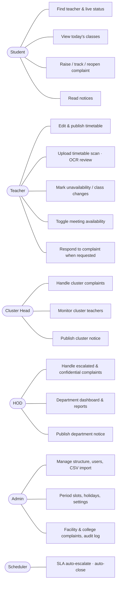

# Software Requirements Specification: CampusConnect

**Institution:** BMS Institute of Technology and Management (BMSIT&M), Bengaluru · **Version:** 1.0 · **Academic year:** 2026–27 (Odd Semester)

## 1. Introduction

### 1.1 Purpose
This document specifies the requirements of **CampusConnect**, a role-based web portal for communication and academic management at BMSIT&M. It is the reference for design, implementation, testing and evaluation.

### 1.2 Scope
CampusConnect gives one portal to students, teachers, Cluster Heads, HODs and the college office for:
- period-based **timetables** and **live teacher availability**;
- teacher **unavailability** (status updates, not HR leave);
- **complaint management** with automatic routing, SLA tracking and escalation;
- **announcements** and in-app **notifications**;
- administration of the college **structure** (Department → Clusters → Sections).

Out of scope: attendance, marks/results, fee payment, HR leave approval, timetable *generation*. Timetables are entered by teachers, not computed.

### 1.3 Definitions
| Term | Meaning |
|---|---|
| Cluster | A group of teachers and sections inside a department. Each cluster has exactly one Cluster Head (CH) |
| Section | A class of students, e.g. CSE **5A**. Belongs to one cluster |
| Period / slot | A numbered teaching period (P1…P7). Breaks are unnumbered slots |
| SLA | Service-level agreement: a complaint must be acted on within *N* working days (default 5) |
| Working day | A configured weekday that is not a holiday and not an off-Saturday (2nd/4th Saturday rule) |
| RLS | Postgres Row Level Security: per-row access rules enforced by the database |

## 2. Overall description

### 2.1 Actors
| Actor | Description | How they get an account |
|---|---|---|
| Student | Belongs to one section (and through it, one cluster and department) | Self sign-up (USN + section) or CSV import |
| Teacher | Belongs to one department and one cluster | Self sign-up (employee ID + cluster) or CSV import |
| Cluster Head | A teacher who heads a cluster. **One per cluster** | Self sign-up for a *vacant* cluster, or appointed by Admin |
| HOD | A teacher who heads a department. **One per department** | Self sign-up for a *vacant* department, or appointed by Admin |
| Admin | College office, super-administrator | Created by the system owner (never self-service) |
| System (scheduler) | Runs SLA auto-escalation and auto-close | Cron job |

### 2.2 Use-case overview

### 2.3 Constraints
- Next.js (App Router, TypeScript) + Supabase (Postgres, Auth, Storage, Realtime). Deployable on Vercel's free tier.
- All calendar logic in **Asia/Kolkata**.
- Free OCR only (Tesseract.js). OCR output is never published without human review.

## 3. Functional requirements

### 3.1 Accounts and access
| ID | Requirement |
|---|---|
| FR-1 | Users sign in with email and password. Demo mode offers one-click demo accounts |
| FR-2 | Students sign up with name, email, USN (VTU format, e.g. `1BY24CS045`), department and section |
| FR-3 | Teachers sign up with employee ID, designation, department and cluster |
| FR-4 | A user may sign up as Cluster Head only for a cluster without one, and as HOD only for a department without one. Otherwise the system rejects it with "already has a Cluster Head/HOD" |
| FR-5 | Each role sees only its own area. Requests for another role's page return **HTTP 403** |
| FR-6 | Cluster Heads and HODs can also use the teacher area (they teach) |
| FR-7 | Deactivated users cannot sign in. Unverified users see a "pending verification" badge |

### 3.2 Timetable
| ID | Requirement |
|---|---|
| FR-8 | Admin configures period slots (label, start, end, break) and working days with a Saturday rule |
| FR-9 | A timetable entry = teacher + day + one or more consecutive periods + subject code/name + section + room + type (Theory/Lab/Tutorial/Mentoring/Meeting) |
| FR-10 | Teachers edit a weekly grid: click to add, drag down to span lab periods, duplicate to other days, keyboard navigation |
| FR-11 | Timetables are versioned DRAFT → PUBLISHED. Publishing archives the previous version. Only one published version per teacher |
| FR-12 | Before publishing: teacher double-booking **blocks**; room double-booking and section clash with other teachers show **warnings** |
| FR-13 | Publish shows a summary ("N classes, M labs, K conflicts") |
| FR-14 | Teachers can upload a JPG/PNG/PDF. OCR builds a draft, and the review screen shows the original next to the editable grid with low-confidence cells highlighted. Publishing is blocked until every low-confidence cell is confirmed |

### 3.3 Availability
| ID | Requirement |
|---|---|
| FR-15 | The system computes each teacher's live status in this priority: On Leave → Holiday → Off Campus Hours → schedule override → In Class → Available (meetings on) → Busy (meetings off) → Timetable Not Published |
| FR-16 | Status shows context, e.g. "21CS53 · 5A · Room 204 until 12:00 PM", "Free until 2:40 PM", "Back on Mon, 23 Nov" |
| FR-17 | The meeting toggle affects only free periods and can never override statuses 1–5 |
| FR-18 | Teachers mark unavailability: full day, half day (FN/AN), date range or specific periods. It takes effect immediately with no approval |
| FR-19 | On unavailability, students of affected sections and the Cluster Head are notified, and affected slots show "Teacher unavailable" |
| FR-20 | The unavailability reason is private (teacher, CH, HOD, Admin) and never shown to students. Future unavailability can be cancelled |
| FR-21 | Teachers can cancel a single class or add an extra class (schedule overrides) |
| FR-22 | Find a Teacher: search and filters (department, cluster, subject, "Available now"), live status cards with cabin location |
| FR-23 | Teacher profile: status, Right now / Next, weekly grid with a "Now" marker, upcoming unavailability banner, meeting note |
| FR-24 | Status views update live (Realtime) and show "Updated just now" |

### 3.4 Complaints
| ID | Requirement |
|---|---|
| FR-25 | Students raise complaints with a 3-step wizard (Category → Details & evidence → Review) that shows who will receive it before submission |
| FR-26 | Routing: against a teacher → CH of that teacher's cluster (teacher is the CH → HOD; teacher is the HOD → Admin); academic → student's CH; department → HOD; facility and college-wide → Admin; confidential → HOD directly. A vacant office falls back one level |
| FR-27 | Complaint IDs are sequential per year: `CMP-2026-0001` |
| FR-28 | Statuses: SUBMITTED, ASSIGNED, UNDER_REVIEW, ACTION_TAKEN, RESOLVED, CLOSED, ESCALATED, REOPENED |
| FR-29 | Handlers can change status, request a teacher response, escalate and resolve (remarks required), and add internal notes students never see |
| FR-30 | A teacher may respond **only** after a handler requests it, and can never change status, see confidential complaints or delete anything |
| FR-31 | SLA: if not acted on within *N* working days at CH level, the complaint auto-escalates to the HOD. An SLA countdown chip is shown |
| FR-32 | The student may reopen **once** within 7 days of resolution (reason required). Resolved complaints auto-close after 7 days |
| FR-33 | Confidential mode: name, USN and section are shown as "Confidential Student" to everyone except the HOD and Admin. The accused teacher never gets access |
| FR-34 | Every status change, assignment and message is written to an immutable timeline |
| FR-35 | Anti-abuse: max 3 complaints per student per day. Evidence: ≤ 5 files, ≤ 5 MB each, JPG/PNG/PDF |

### 3.5 Notifications and announcements
| ID | Requirement |
|---|---|
| FR-36 | In-app bell with live unread count and a notifications page. Events: assigned, status changed, new message, response requested, escalated, resolved, teacher unavailable, timetable published, new announcement |
| FR-37 | Announcements are scoped College (Admin) / Department (HOD) / Cluster (CH), with audience students/teachers/both and optional semester and section filters, pin, attachment and expiry. Unread notices show a dot |

### 3.6 Administration and reporting
| ID | Requirement |
|---|---|
| FR-38 | Admin manages departments, clusters and sections in a tree, appoints HODs/CHs and moves teachers between clusters |
| FR-39 | Admin verifies, activates or deactivates users and changes roles (Student/Teacher/Admin) |
| FR-40 | CSV bulk import of students and teachers with an in-browser preview and per-row results |
| FR-41 | CH/HOD dashboards: KPIs (open, overdue SLA, resolved this month, average resolution days), complaint table, teachers on leave today, unpublished timetables. The HOD also gets a cluster comparison chart |
| FR-42 | The audit log records administrative and workflow actions |
| FR-43 | Demo mode provides "Simulate time" to pin the clock for demonstrations |

## 4. Non-functional requirements
| ID | Category | Requirement |
|---|---|---|
| NFR-1 | Security | Authorisation is enforced on the server and by RLS on every table. Hiding UI is never the only control |
| NFR-2 | Privacy | A student can never read another student's complaint. Leave reasons and internal notes are never sent to students |
| NFR-3 | Performance | Pages load in < 2 s on normal data. Indexes on all foreign keys, `(teacher_id, day_of_week)` and `complaints(status, current_assignee_id)` |
| NFR-4 | Accessibility | WCAG 2 AA contrast, keyboard navigable, visible focus. Status is never conveyed by colour alone |
| NFR-5 | Responsiveness | 360 px to 1440 px with no horizontal page scroll. Bottom tab bar for students on phones |
| NFR-6 | Reliability | Lists show loading skeletons, empty states and error states with retry |
| NFR-7 | Maintainability | Business rules live in pure, unit-tested modules (`lib/services/*`) |
| NFR-8 | Auditability | The complaint timeline is append-only. Admin actions are logged |
| NFR-9 | Portability | Runs on Vercel + Supabase free tiers. Configuration via environment variables |
