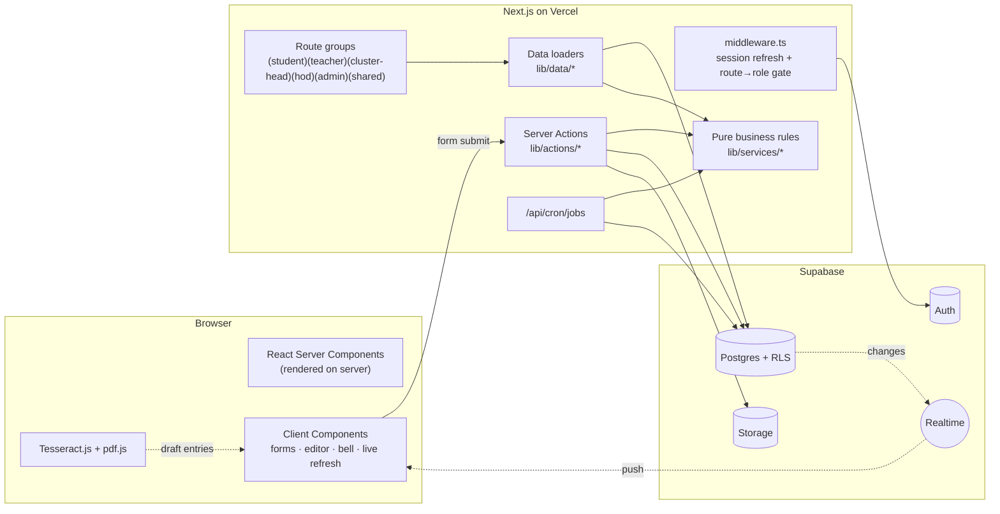
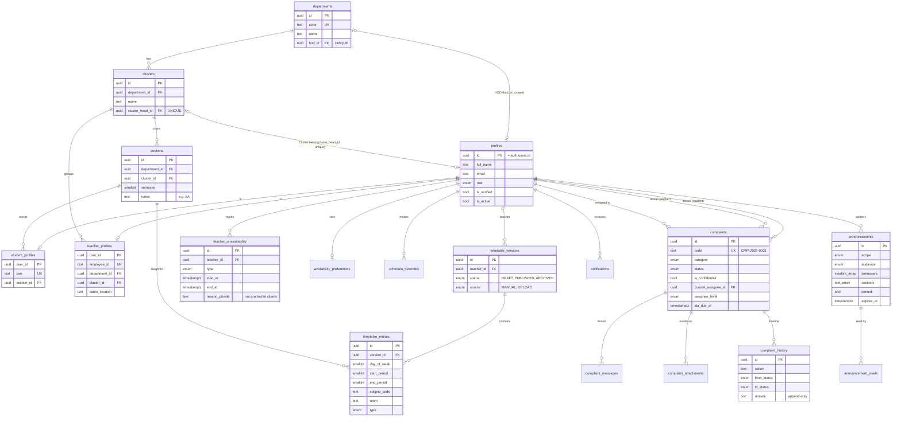
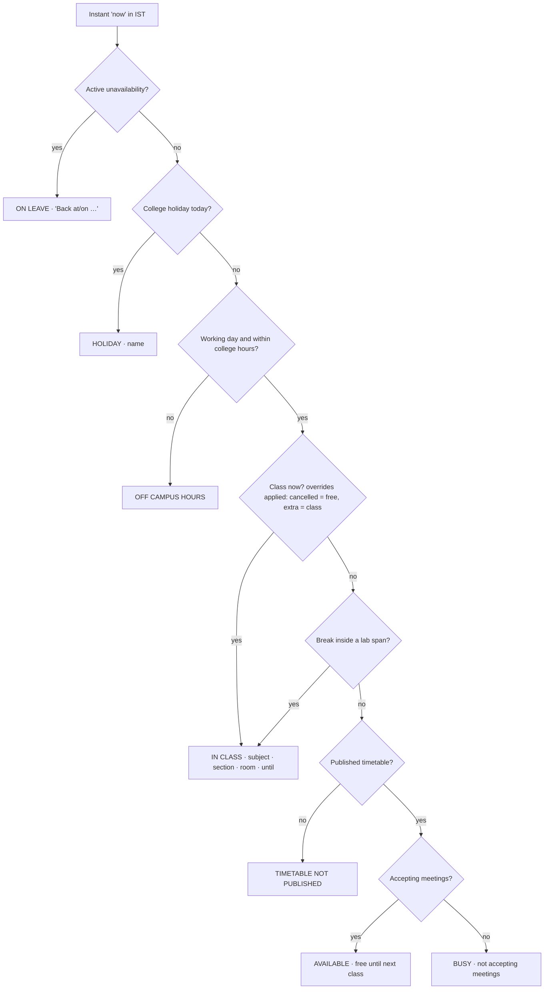
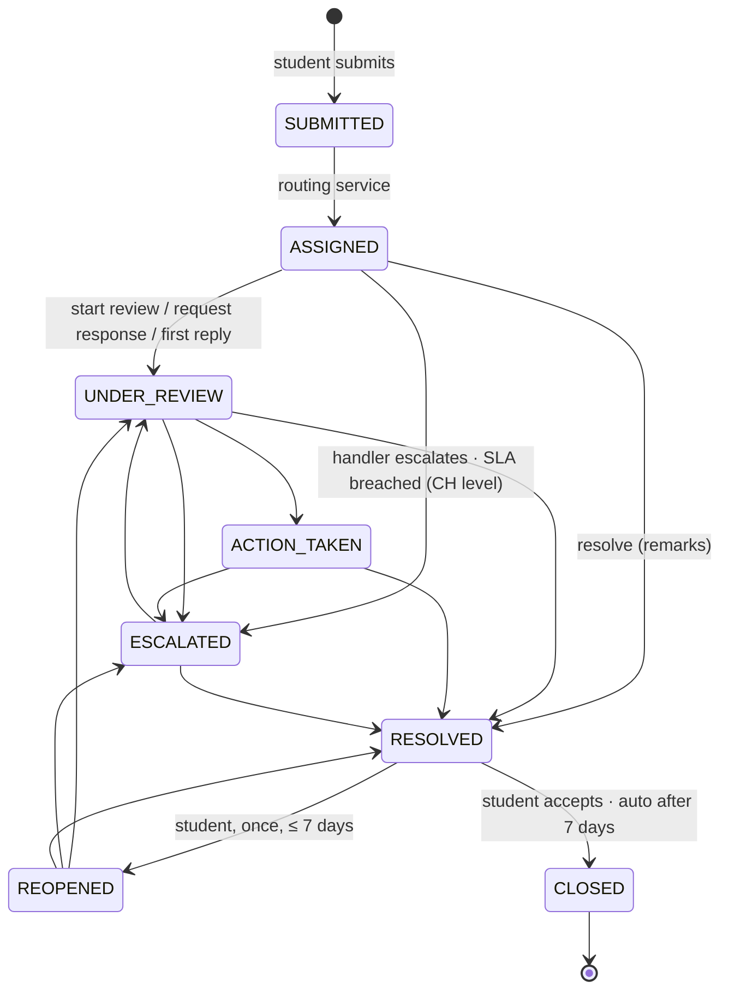
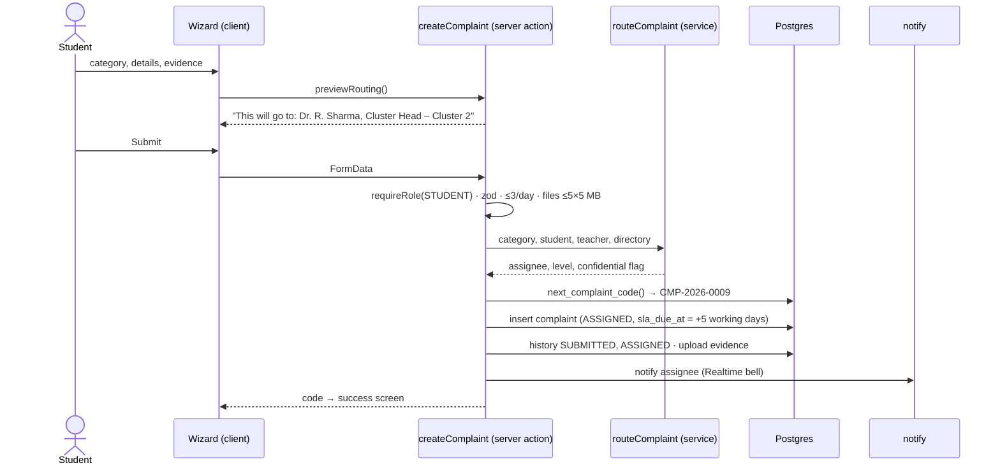
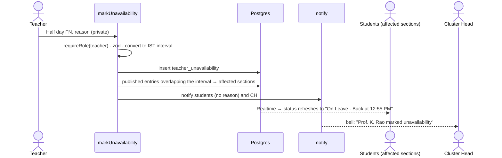

# Design Document: CampusConnect

## 1. Architecture

**Layering rule:** UI components never contain business rules. Pages call `lib/data/*`, which fetches rows and calls the pure functions in `lib/services/*`. Mutations go through `lib/actions/*`, which authenticate, validate with zod, check workflow rules, then write. The same rules are mirrored in SQL (RLS helper functions) so the database enforces them even if application code has a bug.

### Folder map
| Folder | Responsibility |
|---|---|
| `app/(auth)` | login, sign-up |
| `app/(student)`, `(teacher)`, `(cluster-head)`, `(hod)`, `(admin)` | role areas. Each layout calls `requireRole()` |
| `app/(shared)` | find a teacher, teacher profile, complaint detail, notices, notifications, account |
| `lib/services` | availability engine, routing, workflow, access, validation, OCR parser, targeting, time |
| `lib/data` | server-only loaders (viewer, calendar, availability, complaints, …) |
| `lib/actions` | server actions (auth, timetable, availability, complaints, announcements, admin, demo) |
| `lib/server` | notify (+ email stub), audit, scheduled jobs, action helpers |
| `supabase/migrations` | schema, RLS, triggers, storage, realtime |
| `tests/unit`, `tests/e2e` | Vitest, Playwright |

## 2. Data model (ER diagram)

Supporting tables: `college_settings` (single row), `period_slots`, `holidays`, `complaint_counters`, `audit_logs`.

**Key constraints**
- `departments.hod_id` and `clusters.cluster_head_id` are `UNIQUE`, so a person heads at most one unit. Each unit has one head by design.
- Composite FK `(cluster_id, department_id) → clusters(id, department_id)`: a section's or teacher's cluster must belong to the same department.
- Exclusion constraint on `timetable_entries (version_id, day_of_week, int4range(start_period, end_period))`: a teacher can never have two overlapping entries in one version, enforced by the database.
- Partial unique indexes: one `PUBLISHED` and at most one `DRAFT` version per teacher.
- `complaint_history` has a trigger that rejects UPDATE and DELETE (immutable timeline).

## 3. Availability engine

`computeTeacherStatus()` in `lib/services/availability.ts` is a pure function. The first rule that matches wins:

The meeting toggle is consulted only in the last step, so it can never override leave, holiday, off hours or a class (FR-17). The leave *reason* is not an input to the function, so it cannot leak into any status (FR-20).

## 4. Complaint workflow

`allowedActions(complaint, viewer, now)` in `complaintWorkflow.ts` is the single decision point. The UI renders only the allowed buttons, and every server action re-checks it before writing.

### Sequence: raising a complaint

### Sequence: marking unavailability

## 5. Security model

| Layer | Mechanism | Example |
|---|---|---|
| Edge | `middleware.ts` verifies the JWT and maps route prefix → roles | Student opening `/admin` gets a 403 rewrite |
| Server | `requireRole()` in every layout, page and action, plus zod validation and `allowedActions()` | A teacher cannot call `complaintAction(RESOLVE)` |
| Database | RLS on every table, SECURITY DEFINER helpers that mirror the services, column grants | `complaints` readable only via `can_view_complaint()` |
| Storage | Private buckets; short-lived signed URLs issued after an access check | Evidence links expire after 10 minutes |

Details:
- **Roles** live in `profiles.role` and are synced to the JWT claim `app_metadata.role` by triggers in both directions. Users can't write `app_metadata`, and column grants stop them updating their own role.
- **Messages** carry an audience (`PUBLIC` / `INTERNAL` / `TEACHER`). The RLS policy sends students only `PUBLIC` messages, so internal notes physically never reach a student's browser.
- **The leave reason** is excluded from the column grant. Only the teacher, their CH, their HOD and the Admin can read it.
- **Masking:** confidential complaints are invisible to Cluster Heads and teachers (RLS). For the remaining viewers, `shouldMaskStudent()` replaces the student's identity below HOD level.

## 6. Key design decisions

| Decision | Alternatives considered | Reason |
|---|---|---|
| Pure business-rule modules + SQL mirrors | Rules only in UI, or only in SQL | Testable in milliseconds, explainable, and RLS still protects data if app code is wrong |
| Period-number timetable (P1…P7) | Free-form start/end times | Matches how Indian colleges print timetables. Labs are simple spans |
| Status computed on read | Storing a status column | Always correct for any instant, including simulated time. No background updater needed |
| OCR in the browser | Server-side OCR | Free, no server CPU limits on Vercel, and the image never leaves the user until upload |
| OCR at a normalised ~2,500 px width, sparse-text mode, known-code correction | Raw upload resolution, default layout mode | Measured on a real printed timetable: 1/12 codes correct before, 12/12 after (defect D11) |
| Atomic head-seat claim (`UPDATE … WHERE head IS NULL`) | Check-then-insert | Two simultaneous sign-ups cannot both become HOD |
| Server Actions | Separate REST API | Less code, type-safe, and runs next to the server-side auth checks |
